# Diagrama de classes: arquitetura-alvo

Modelo da arquitetura descrita na proposta (Checkpoint 1, Parte A). Classes novas ou alteradas em relação a
[diagrama-classes-atual.md](diagrama-classes-atual.md) estão marcadas com `<<novo>>` ou `<<muda>>`.

> A hierarquia de inimigos, `Damageable`, `EnemyFactory` e o `SoundManager` (Singleton) já estão **implementados** como
> aparecem abaixo. O ranking online (`RankingClient`, `ScoreEntry`, `RankingScreen`, `NameInputScreen`, `NetworkException`)
> continua sendo proposta do Mairon.

```mermaid
classDiagram
    direction TB

    %% ---------- Interface de dano ----------
    class Damageable {
        <<interface>>
        +takeDamage(int amount, Vector2f impact)* DamageResult
        +isAlive()* bool
        +isHitBy(Vector2f point, float radius)* bool
        +getBounds()* FloatRect
    }

    class DamageResult {
        <<enumeration>>
        Ignored
        Damaged
        Dead
    }

    %% ---------- Hierarquia de inimigos ----------
    class FormationState {
        <<struct>>
        +float offsetX
        +float stepY
        +int wave
    }

    class Enemy {
        <<abstract>>
        -EnemyType m_type
        -int m_hp
        -int m_maxHp
        -bool m_alive
        -float m_shootTimer
        -float m_shootInterval
        #Vector2f m_pos
        #Vector2f m_base
        +update(dt, playerPos, FormationState, bullets) void
        +updateExplosion(dt) void
        +takeDamage(amount, impact) DamageResult
        +isAlive() bool
        +isHitBy(point, radius) bool
        +getBounds() FloatRect
        +scoreValue()* int
        +color()* Color
        +rams(playerPos) bool
        +isGone() bool
        #move(dt, playerPos, FormationState)* void
        #attack(bullets)* void
        #canAttack() bool
    }

    class Drone {
        +scoreValue() int
        +color() Color
        #move(dt, playerPos, form) void
        #attack(bullets) void
    }
    class Invader {
        +scoreValue() int
        +color() Color
        #move(dt, playerPos, form) void
        #attack(bullets) void
    }
    class Brute {
        +scoreValue() int
        +color() Color
        #move(dt, playerPos, form) void
        #attack(bullets) void
    }
    class Kamikaze {
        -bool m_diving
        -float m_diveTimer
        +rams(playerPos) bool
        #move(dt, playerPos, form) void
        #attack(bullets) void
        #canAttack() bool
    }
    class Elite {
        +scoreValue() int
        +color() Color
        #move(dt, playerPos, form) void
        #attack(bullets) void
    }
    class UFO {
        -float m_dir
        +isHitBy(point, radius) bool
        +isGone() bool
        #move(dt, playerPos, form) void
        #attack(bullets) void
        #canAttack() bool
    }

    class EnemyType {
        <<enumeration>>
        Drone
        Invader
        Brute
        Kamikaze
        Elite
        UFO
    }

    class EnemyFactory {
        <<factory>>
        +create(EnemyType type, Vector2f pos, int wave)$ unique_ptr~Enemy~
        +createUfo(int wave)$ unique_ptr~Enemy~
        +createFormation(int wave)$ vector~unique_ptr~Enemy~~
        +typeForRow(int row)$ EnemyType
    }

    class EnemyManager {
        <<muda>>
        -vector~unique_ptr~Enemy~~ m_enemies
        -unique_ptr~Enemy~ m_ufo
        -vector~PowerUp~ m_powerups
        +spawnFormation(wave)
        +update(dt, playerPos, bullets, fx, onKill, onKamikazeHit)
        +draw(rt)
        +allDead() bool
        +hasReachedBottom() bool
        +getEnemies() vector~unique_ptr~Enemy~~
        +hasUFO() bool
    }

    %% ---------- Outros Damageable ----------
    class Player {
        <<muda>>
        -int m_lives
        -int m_score
        +takeDamage(amount, impact) DamageResult
        +isAlive() bool
        +isHitBy(point, radius) bool
        +getBounds() FloatRect
        +applyPowerup(type)
    }

    class Shield {
        <<muda>>
        -vector~ShieldBlock~ m_blocks
        +takeDamage(amount, impact) DamageResult
        +isAlive() bool
        +isHitBy(point, radius) bool
        +getBounds() FloatRect
    }

    %% ---------- Colisão ----------
    class Game {
        <<muda>>
        -collide(Bullet, Damageable, radius) optional~DamageResult~
        -hitShields(Bullet) bool
        -damagePlayer(amount, impact) DamageResult
        -submitScore()
    }

    class BulletManager {
        +getAll() vector~Bullet~
    }

    %% ---------- Singleton de áudio ----------
    class SoundManager {
        <<singleton>>
        -SoundManager()
        -m_pool
        +instance()$ SoundManager
        +play(id, vol, pitch)
        +setMasterVolume(v)
    }

    %% ---------- Ranking online (extras: API + banco) ----------
    class RankingClient {
        <<novo>>
        -string baseUrl
        -string apiKey
        +submitScore(ScoreEntry) void
        +fetchTop(int n) vector~ScoreEntry~
    }

    class ScoreEntry {
        <<novo>>
        +string playerName
        +int score
        +int wave
    }

    class RankingScreen {
        <<novo>>
        -vector~ScoreEntry~ entries
        -float refreshTimer
        +update(dt)
        +draw(rt)
    }

    class NameInputScreen {
        <<novo>>
        -string name
        +handleEvent(ev)
        +draw(rt)
    }

    %% ---------- Persistência local e exceções ----------
    class Storage {
        <<novo>>
        +readHighScore(path)$ int
        +writeHighScore(path, score)$ void
        +readVolume(path)$ float
        +writeVolume(path, volume)$ void
    }

    class GameException {
        <<novo>>
    }
    class AssetLoadException {
        <<novo>>
    }
    class PersistenceException {
        <<novo>>
    }
    class InvalidDataException {
        <<novo>>
    }
    class NetworkException {
        <<novo - Mairon>>
    }

    %% ---------- Relações ----------
    Damageable <|.. Player
    Damageable <|.. Enemy
    Damageable <|.. Shield

    Enemy <|-- Drone
    Enemy <|-- Invader
    Enemy <|-- Brute
    Enemy <|-- Kamikaze
    Enemy <|-- Elite
    Enemy <|-- UFO
    Enemy ..> FormationState : recebe

    EnemyFactory ..> Enemy : cria
    EnemyFactory ..> EnemyType
    EnemyManager "1" o-- "*" Enemy
    EnemyManager ..> EnemyFactory : usa na onda e para o UFO

    Damageable ..> DamageResult

    Game *-- EnemyManager
    Game *-- Player
    Game *-- BulletManager
    Game o-- "4" Shield
    Game ..> Damageable : colisão polimórfica
    Game ..> SoundManager : SFX
    Game ..> Storage
    Game ..> RankingClient
    Game *-- RankingScreen
    Game *-- NameInputScreen

    RankingClient ..> ScoreEntry
    RankingScreen ..> RankingClient : consulta a cada N s
    NameInputScreen ..> ScoreEntry : monta

    GameException <|-- AssetLoadException
    GameException <|-- PersistenceException
    PersistenceException <|-- InvalidDataException
    GameException <|-- NetworkException
    Storage ..> PersistenceException : lança
    Storage ..> InvalidDataException : lança
    RankingClient ..> NetworkException : lança
```

## Como cada requisito da disciplina aparece no diagrama

| Requisito | Onde está |
|---|---|
| Classe abstrata | `Enemy` (`move`, `attack`, `scoreValue` e `color` são puramente virtuais) |
| Herança | `Drone`, `Invader`, `Brute`, `Kamikaze`, `Elite`, `UFO` herdam de `Enemy` |
| Interface | `Damageable`, implementada por `Player`, `Enemy` e `Shield` |
| Polimorfismo | `Game::collide(Bullet, Damageable)` trata `Shield` e `Player` da mesma forma e `EnemyManager` aplica o dano em qualquer `Enemy` pela mesma interface; cada `Enemy` se move/ataca do seu jeito |
| Padrão Factory | `EnemyFactory` monta as formações de cada onda e cria o UFO |
| Padrão Singleton | `SoundManager::instance()`, com construtor privado e cópia proibida |
| Tratamento de exceções | hierarquia `GameException` (já implementada em `Exceptions.h`; `NetworkException` fica com o Mairon) |
| API / banco / GUI | `RankingClient` (REST via libcurl), `RankingScreen`, `NameInputScreen` |

## Decisões de projeto

1. **`Shield` e `Damageable`**: o escudo é formado por blocos (`ShieldBlock`). A interface recebe o ponto de impacto em
   `takeDamage(amount, impact)` e `isHitBy(point, radius)`, de modo que o `Shield` localiza o bloco atingido sem guardar estado
   entre chamadas. `Player` e `Enemy` ignoram o ponto de impacto. `Shield` devolve `Damaged` enquanto restar algum bloco e `Dead` quando o último cai.
2. **Propriedade dos inimigos**: `std::unique_ptr<Enemy>` em `EnemyManager`; a Factory devolve `unique_ptr`, e quem recebe passa a ser o dono.
3. **O UFO** deixou de ter estado próprio dentro de `EnemyManager` e é mais um `Enemy` criado pela Factory (`EnemyFactory::createUfo`).
4. **`EnemyType`** continua em `Spritegen.h`, porque também indexa as texturas; a Factory o usa para escolher a subclasse.
5. **`FormationState`** (deslocamento lateral, degrau vertical e onda) é passado a `Enemy::update`, então as subclasses se movem sem conhecer o `EnemyManager`.
6. **Template Method**: `Enemy::update` define a ordem (movimento e tiro) e as subclasses preenchem `move`, `attack` e `canAttack`.
