# Diagrama de classes: versão atual (v1)

Levantado a partir do código do commit `99ca96f` (branch `main`), antes da refatoração.
Serve de ponto de partida para o diagrama-alvo em [diagrama-classes-alvo.md](diagrama-classes-alvo.md).

```mermaid
classDiagram
    direction LR

    class Game {
        -RenderWindow m_window
        -Font m_font
        -GameState m_state
        -int m_wave
        -int m_hiScore
        -float m_volume
        +Game()
        +run()
        -processEvents()
        -update(dt)
        -render()
        -startGame()
        -nextWave()
        -checkPlayerBulletVsShields()
        -checkEnemyBulletVsShields()
        -checkEnemyBulletVsPlayer()
        -checkPowerupVsPlayer()
        -loadHighScore()
        -saveHighScore()
        -loadSettings()
        -saveSettings()
    }

    class GameState {
        <<enumeration>>
        Menu
        Countdown
        Playing
        Paused
        GameOver
        Win
    }

    class Player {
        -Vector2f m_pos
        -int m_lives
        -int m_score
        -float m_invulTimer
        -float m_rapidTimer
        -float m_tripleTimer
        -float m_shieldTimer
        +init()
        +update(dt, bullets, fx)
        +draw(rt)
        +takeDamage(fx) DamageResult
        +applyPowerup(type)
        +addScore(s)
        +addLife()
        +getBounds() FloatRect
        +isAlive() bool
        +isInvul() bool
        +hasShield() bool
    }

    class DamageResult {
        <<enumeration>>
        Ignored
        Damaged
        Dead
    }

    class Enemy {
        <<struct>>
        +Vector2f pos
        +Vector2f formationBase
        +float halfW
        +float halfH
        +EnemyType type
        +int hp
        +int maxHp
        +bool alive
        +float shootTimer
        +float shootInterval
        +float phase
        +bool isDiving
        +float hitFlash
        +bool exploding
    }

    class EnemyType {
        <<enumeration>>
        Drone
        Invader
        Brute
        Kamikaze
        Elite
        UFO
    }

    class EnemyManager {
        -vector~Enemy~ m_enemies
        -vector~PowerUp~ m_powerups
        -float m_formX
        -float m_formSpeed
        -int m_wave
        -bool m_ufoAlive
        -int m_aliveCount
        +spawnFormation(wave)
        +update(dt, playerPos, bullets, fx, onKill, onKamikazeHit)
        +draw(rt)
        +allDead() bool
        +hasReachedBottom() bool
        +getLowestEnemyPos() Vector2f
        +updateUFO(dt, bullets, fx, onKill)
        +stopUFOLoop()
        +getPowerups() vector~PowerUp~
        -applyTypeMovement(e, dt, playerPos)
        -tryEnemyShoot(e, bullets, dt)
        -randomDrop() PowerupType
    }

    class PowerUp {
        +Vector2f pos
        +PowerupType type
        +bool alive
    }

    class PowerupType {
        <<enumeration>>
        None
        Rapid
        Triple
        Shield
    }

    class Bullet {
        +Vector2f pos
        +Vector2f vel
        +BulletOwner owner
        +bool alive
        +Color color
    }

    class BulletOwner {
        <<enumeration>>
        Player
        Enemy
    }

    class BulletManager {
        -vector~Bullet~ m_bullets
        +spawnPlayer(pos)
        +spawnEnemy(pos, color)
        +spawnTriple(pos)
        +update(dt)
        +draw(rt)
        +killAll()
        +getAll() vector~Bullet~
    }

    class ShieldBlock {
        <<struct>>
        +Vector2f pos
        +int hp
        +bool alive
    }

    class Shield {
        -vector~ShieldBlock~ m_blocks
        -FloatRect m_bounds
        +init(topLeft)
        +draw(rt)
        +checkBulletHit(bulletPos, radius) bool
        +getBounds() FloatRect
    }

    class ShieldManager {
        -vector~Shield~ m_shields
        -VertexArray m_shieldVerts
        +init()
        +draw(rt)
        +checkBulletHit(pos, r) bool
        +reset()
        +markDirty()
    }

    class Particle {
        <<struct>>
        +Vector2f pos
        +Vector2f vel
        +Color color
        +float life
    }

    class FloatingText {
        <<struct>>
        +Vector2f pos
        +string text
        +float life
    }

    class ParticleSystem {
        -vector~Particle~ m_particles
        -vector~FloatingText~ m_texts
        +spawnExplosion(pos, col, count)
        +spawnHit(pos, col)
        +addFloatingScore(pos, score, col)
        +update(dt)
        +draw(rt, font)
        +clear()
    }

    class Background {
        -vector~Star~ m_stars
        +update(dt, shakeX, shakeY)
        +draw(rt)
        +setScrollSpeed(s)
    }

    class SoundManager {
        <<singleton>>
        -array~SoundBuffer~ m_buffers
        -vector~Sound~ m_pool
        -float m_masterVol
        +instance()$ SoundManager
        +loadAll()
        +play(id, vol, pitch)
        +startLoop(id, vol)
        +stopLoop()
        +startMusic(file, vol)
        +stopMusic()
        +setMasterVolume(v)
    }

    class TextureBank {
        <<global GFX>>
        +Texture player
        +array~Texture~ enemy
        +array~Texture~ shield
        +array~Texture~ explosion
        +generate()
    }

    class RoundedRectShape {
        +setSize(size)
        +setCornerRadius(r)
    }

    Game *-- Player
    Game *-- EnemyManager
    Game *-- BulletManager
    Game *-- ShieldManager
    Game *-- ParticleSystem
    Game *-- Background
    Game --> GameState
    Game ..> SoundManager : usa SFX
    Game ..> RoundedRectShape : desenha menus

    EnemyManager "1" *-- "*" Enemy
    EnemyManager "1" *-- "*" PowerUp
    Enemy --> EnemyType
    PowerUp --> PowerupType
    EnemyManager ..> BulletManager : atira
    EnemyManager ..> ParticleSystem : explosões
    EnemyManager ..> SoundManager

    BulletManager "1" *-- "*" Bullet
    Bullet --> BulletOwner

    ShieldManager "1" *-- "4" Shield
    Shield "1" *-- "*" ShieldBlock

    ParticleSystem "1" *-- "*" Particle
    ParticleSystem "1" *-- "*" FloatingText

    Player ..> DamageResult
    Player ..> BulletManager : atira
    Player ..> ParticleSystem
    Player ..> SoundManager
    Player ..> PowerupType

    Enemy ..> TextureBank : tamanho do sprite
    Shield ..> TextureBank
    Player ..> TextureBank
```

## Observações do levantamento

Pontos do código atual que motivam a refatoração prevista na proposta:

1. **`Enemy` é uma `struct` única** diferenciada pelo `enum EnemyType`. O comportamento de cada tipo está espalhado em `switch`/`if` dentro de `EnemyManager`:
   `scoreFor`, `colFor`, `hpFor`, `typeForRow`, `applyTypeMovement` e `tryEnemyShoot` (em `Enemy.cpp`), e `makeEnemy` (em `Spritegen.cpp`).
2. **Não existe abstração de "algo que sofre dano".** Cada colisão é tratada à mão em `Game`
   (`checkEnemyBulletVsPlayer`, `checkPlayerBulletVsShields`...) e em `EnemyManager::update`, e cada alvo tem uma API diferente:
   `Player::takeDamage` devolve `DamageResult`, `Shield::checkBulletHit` devolve `bool` e o inimigo decrementa `hp` direto.
3. **O UFO é tratado à parte** (`m_ufoAlive`, `m_ufoPos`, `updateUFO`, `drawUFO`) em vez de ser um inimigo.
4. **`SoundManager` já é Singleton** (`instance()` + construtor de cópia apagado, acessado pela macro `SFX`), o que está de acordo com a proposta.
5. **`TextureBank GFX` é uma variável global**, dependência implícita de `Player`, `Shield` e `EnemyManager`.
6. **`EnemyType` mora em `Spritegen.h`**, acoplando a lógica de inimigos à geração de sprites.
