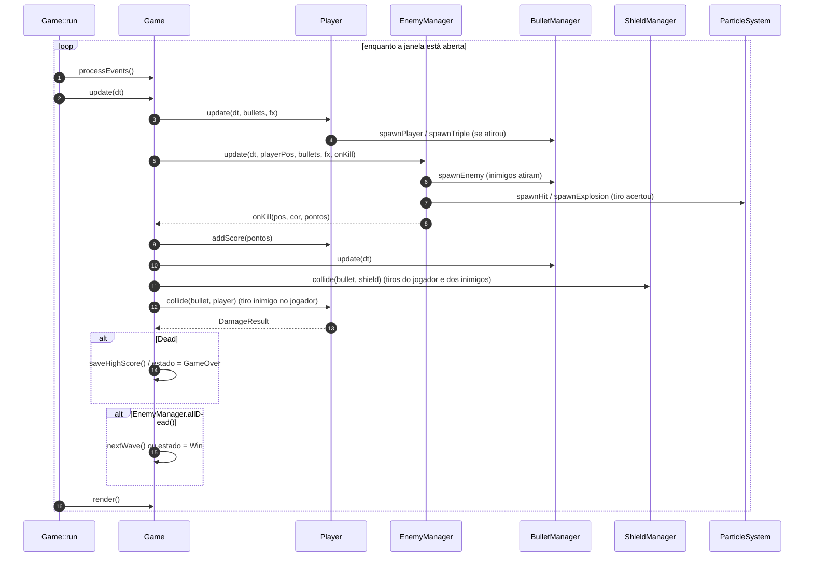
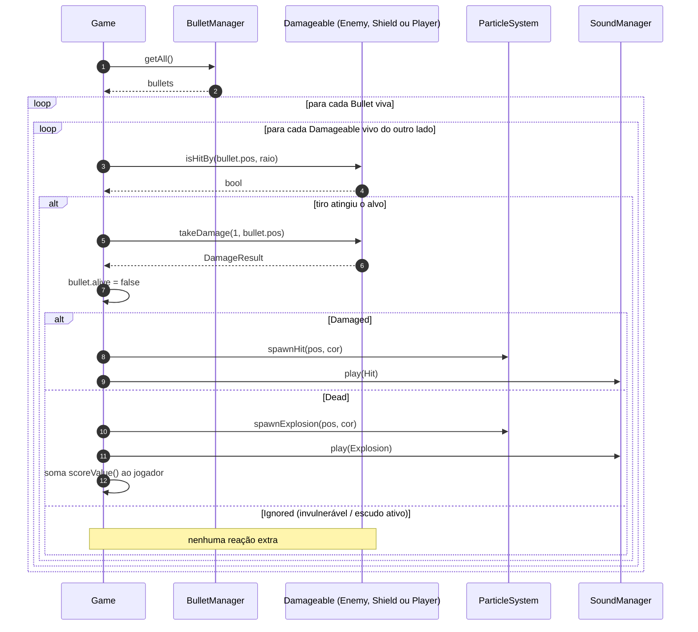
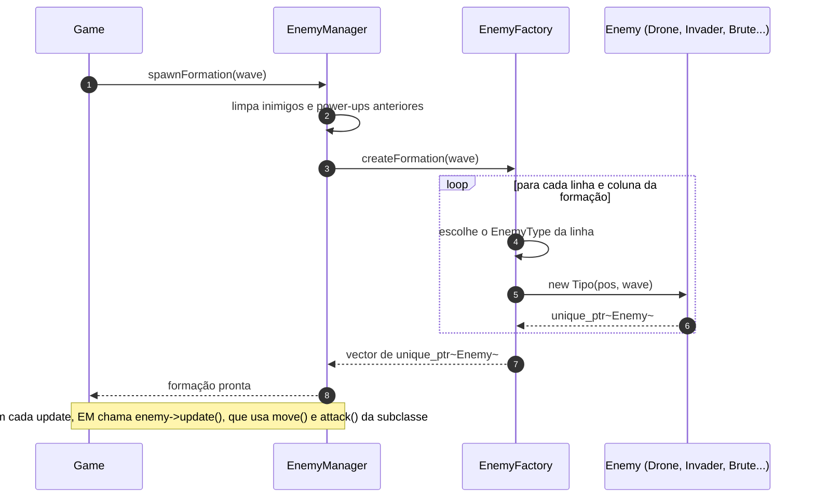
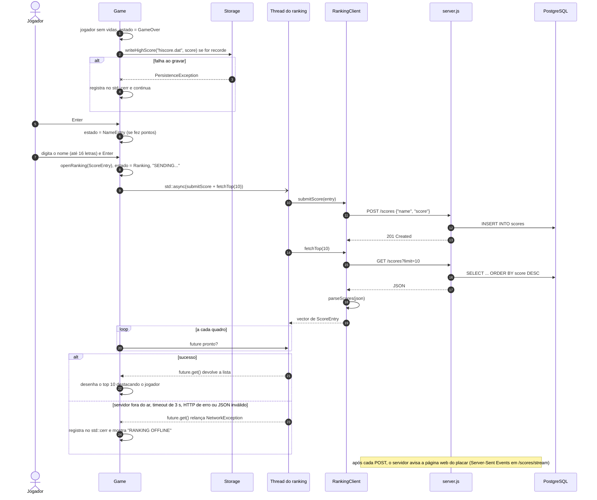

# Diagramas de sequência

Quatro cenários, todos descrevendo o **código atual**: quadro de jogo, colisão polimórfica, montagem de onda e ranking online.

## 1. Um quadro de jogo

`Game::run` → `update(dt)`, como está hoje em `Game.cpp`.

## 2. Tiro contra um alvo (`Damageable`)

Mostra o polimorfismo: `Game` não precisa saber se o alvo é `Drone`, `Brute`, `Shield`…

## 3. Montagem de uma onda (`EnemyFactory`)

## 4. Fim de partida e ranking online

Fluxo de `Game.cpp` (estados `GameOver` → `NameEntry` → `Ranking`), `RankingClient.cpp` e `server/server.js`.
A rede roda em outra thread (`std::async`), então a janela continua desenhando enquanto espera; o `Game` só olha o resultado
em `pollRanking()`, chamado a cada quadro.

