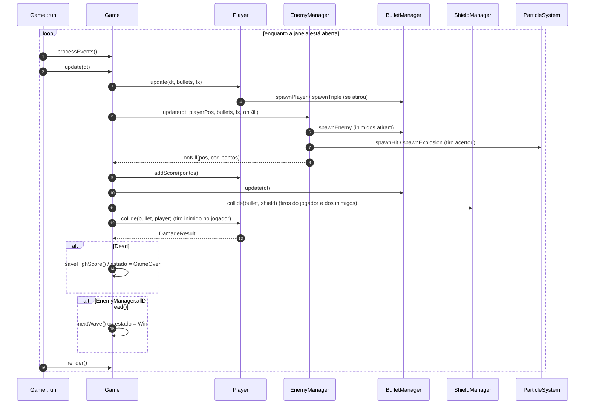
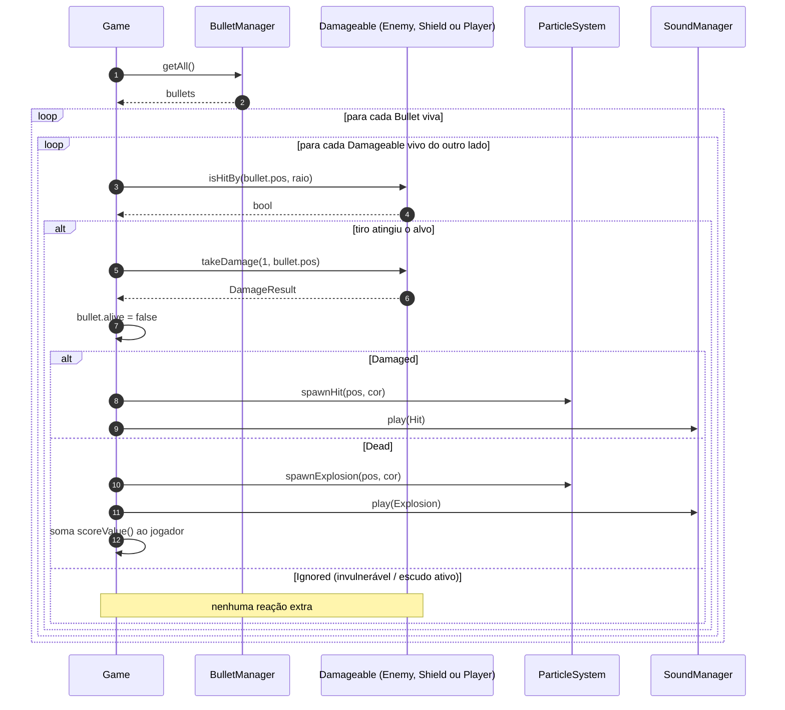
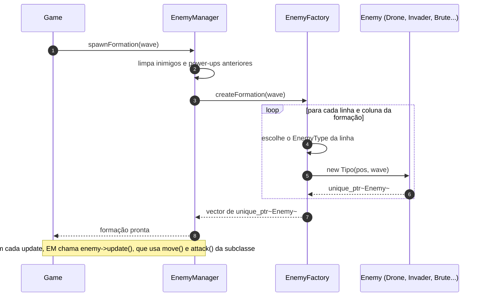
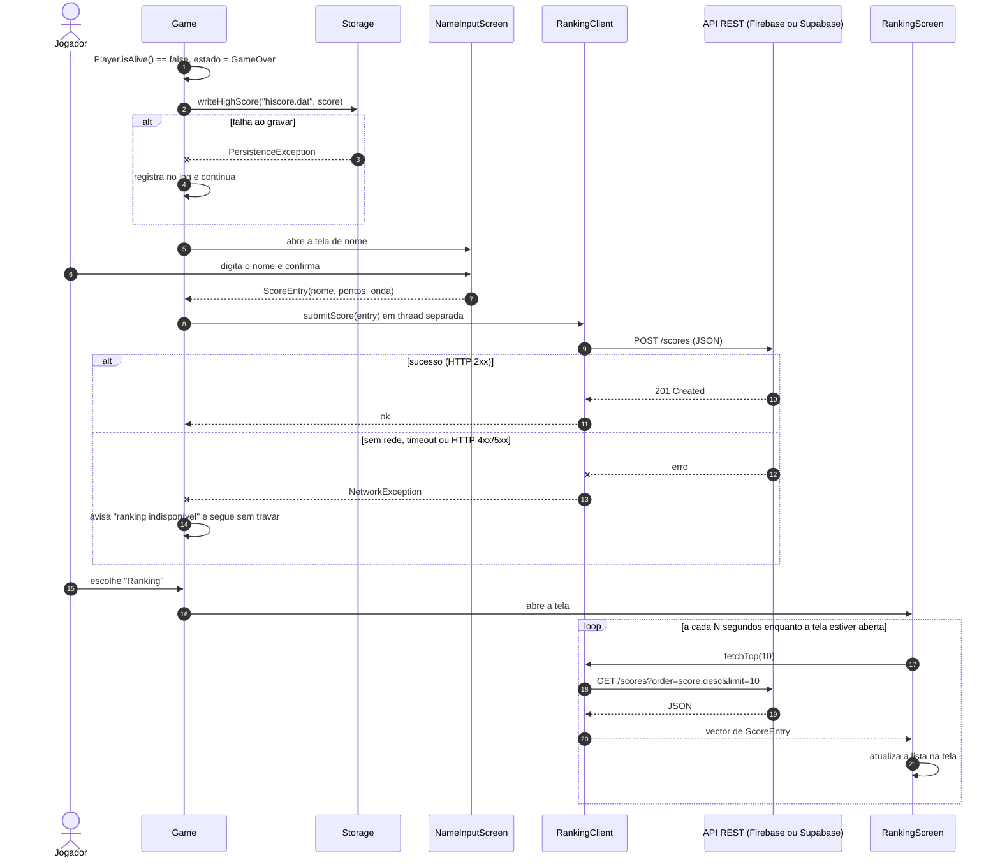

# Diagramas de sequência

Quatro cenários: os três primeiros descrevem o **código atual** (quadro de jogo, colisão polimórfica e montagem de onda) e o último descreve o **comportamento-alvo** do ranking online.

## 1. Um quadro de jogo

`Game::run` → `update(dt)`, como está hoje em `Game.cpp`.

## 2. Tiro contra um alvo (`Damageable`)

Mostra o polimorfismo: `Game` não precisa saber se o alvo é `Drone`, `Brute`, `Shield`…

## 3. Montagem de uma onda (`EnemyFactory`)

## 4. Fim de partida e ranking online (alvo, ainda não implementado)

Fluxo previsto para o diferencial do projeto, com o tratamento de falhas de rede.
O envio deve acontecer em outra thread, para não travar o jogo.

